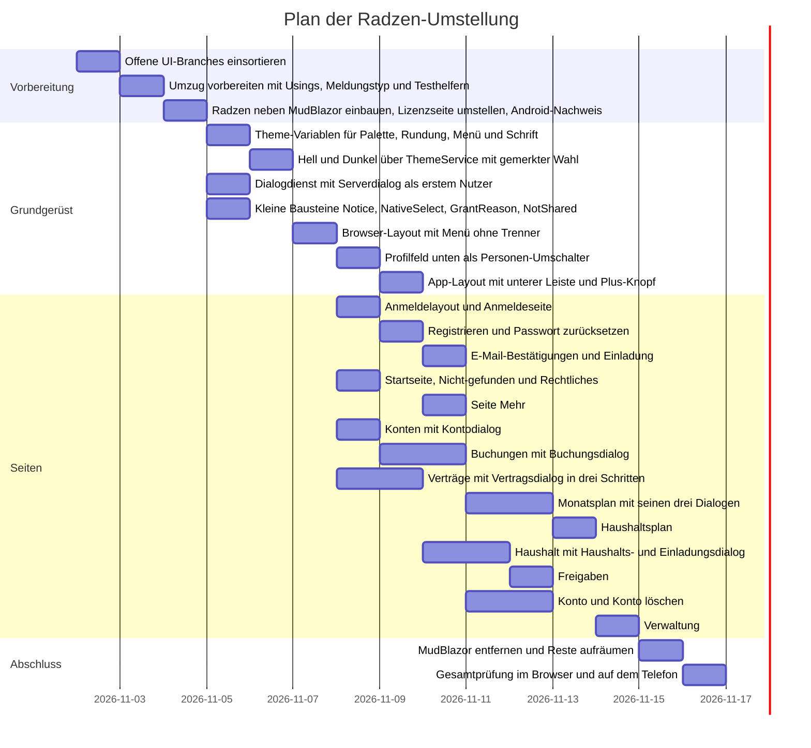

# Plan der Radzen-Umstellung

Sammel-Issue #98. Das gemeinsame UI (Shared, Web, Mobile) zieht vollständig von MudBlazor 9.11 auf Radzen Blazor 12.1.8 um.

**Empfehlung in einem Satz:** Erst den Umzug vorbereiten und Radzen mit einer echten Seite auf dem Android-Telefon nachweisen, dann Theme, Dialogdienst und kleine Bausteine, danach die Layouts und zuletzt die Seiten von klein nach groß. MudBlazor fliegt erst heraus, wenn keine Seite es mehr braucht.

<!-- Check with: bash "${CLAUDE_PLUGIN_ROOT}/skills/cut-issues/check-plan.sh" docs/plans/radzen-plan.md -->

## Tasks

| id | what | depends on | who |
|---|---|---|---|
| R0 | Offene UI-Branches einsortieren | - | lead |
| R1 | Umzug vorbereiten mit Usings, Meldungstyp und Testhelfern | R0 | kai |
| R2 | Radzen neben MudBlazor einbauen, Lizenzseite umstellen, Android-Nachweis | R1 | kai |
| R3 | Theme-Variablen für Palette, Rundung, Menü und Schrift | R2 | kai |
| R4 | Hell und Dunkel über ThemeService mit gemerkter Wahl | R3 | kai |
| R5 | Dialogdienst mit Serverdialog als erstem Nutzer | R2 | ida |
| R6 | Kleine Bausteine Notice, NativeSelect, GrantReason, NotShared | R2 | mia |
| R7 | Browser-Layout mit Menü ohne Trenner | R3, R4, R6 | kai |
| R8 | Profilfeld unten als Personen-Umschalter | R7 | mia |
| R9 | App-Layout mit unterer Leiste und Plus-Knopf | R5, R8 | kai |
| R10 | Anmeldelayout und Anmeldeseite | R5, R7 | mia |
| R11 | Registrieren und Passwort zurücksetzen | R10 | mia |
| R12 | E-Mail-Bestätigungen und Einladung | R11 | mia |
| R13 | Startseite, Nicht-gefunden und Rechtliches | R5, R7 | ida |
| R14 | Seite Mehr | R9 | ida |
| R15 | Konten mit Kontodialog | R5, R7 | ida |
| R16 | Buchungen mit Buchungsdialog | R15 | ida |
| R17 | Verträge mit Vertragsdialog in drei Schritten | R5, R7 | mia |
| R18 | Monatsplan mit seinen drei Dialogen | R16 | ida |
| R19 | Haushaltsplan | R18 | ida |
| R20 | Haushalt mit Haushalts- und Einladungsdialog | R17 | mia |
| R21 | Freigaben | R20 | mia |
| R22 | Konto und Konto löschen | R12 | mia |
| R23 | Verwaltung | R19 | ida |
| R24 | MudBlazor entfernen und Reste aufräumen | R12, R13, R14, R16, R17, R18, R19, R20, R21, R22, R23 | kai |
| R25 | Gesamtprüfung im Browser und auf dem Telefon | R24 | tom |

## Chart

Die Reihenfolge gilt, die Daten sind nur ein Beispiel: Tage sind grob geschätzt, höchstens zwei Worker gleichzeitig.

## Offene Fragen an Tom

Jede Frage hat eine Empfehlung. Frage 1 und 2 sind die beiden aus dem Auftrag, Frage 3 bis 6 sind beim Lesen des Codes dazugekommen.

1. **Wie bedient man die App auf dem Handy?** Radzen 12.1.8 hat keine untere Leiste und keine Vollbild-Einstellung für Dialoge. *Empfehlung:* Wir behalten das bisherige Muster aus Spec 65, also untere Leiste, runden Plus-Knopf und Formulare über den ganzen Bildschirm. Dafür braucht es eine kleine Ausnahme von „kein eigenes CSS“, nur für Lage und Abstand zur Systemleiste. *Alternative:* Das Radzen-Seitenmenü klappt auf dem Handy ein und Formulare gehen als normale Radzen-Dialoge auf. Das braucht kein CSS, aber man erreicht die Ziele mit einem Griff mehr, und lange Formulare sind enger. Blockiert R9, Teile von R5.
2. **Wo merkt sich die App Hell und Dunkel?** *Empfehlung:* Im vorhandenen `IThemePreferenceStore`: in der App die Preferences des Telefons, im Browser der lokale Speicher. Der `ThemeService` von Radzen wendet die Wahl nur an. Das Radzen-Cookie (`AddRadzenCookieThemeService`) nehmen wir nicht, weil es dann zwei Ablagen gäbe. Bleibt es bei den drei Wahlmöglichkeiten hell, dunkel und wie das Gerät, wie auf `feat/theme-switch`? Blockiert R4.
3. **Welche Dunkel-Farben gelten?** Tom hat am 29.10. ein eigenes Dunkel-Design bestätigt (`feat/dark-mode`). Der Spike nimmt dagegen die Flächen des Radzen-Dunkel-Themes und hellt nur die Hauptfarbe auf. *Empfehlung:* das bestätigte Design als `--rz-*`-Werte übernehmen, weil Tom das Dunkel-Design ausdrücklich als schlecht bemängelt hatte. Blockiert R3.
4. **Welche Symbole gelten?** Am 29.10. wurde Tabler gewählt, der Spike und alle Radzen-Komponenten benutzen aber Material Symbols, die im Paket liegen (Apache-Lizenz). Radzen nimmt im Parameter `Icon` nur Namen aus dieser Schrift. *Empfehlung:* Material Symbols, sonst stehen auf einer Seite zwei Symbolstile nebeneinander. Blockiert R3 und R7.
5. **Was passiert mit den 15 offenen Branches?** Keiner davon ist in `main`, viele bauen aufeinander auf und enthalten neue Funktionen in MudBlazor (Monatsplan, Planübersicht, Vertragsdialog, Personen-Umschalter). *Empfehlung:* Alles mit Funktion erst nach `main` holen und dann einmal gemeinsam umstellen, damit weder Logik noch Tests verloren gehen. Details stehen unter R0. Blockiert den Start.
6. **Wird der Umbau erst am Ende sichtbar?** *Empfehlung:* Die Slices landen auf einem Sammelbranch `feat/radzen`, und `main` bleibt bis nach R25 auf MudBlazor. Eine App mit halb alten, halb neuen Seiten sollte nicht live gehen, und Fehlerkorrekturen auf `main` bleiben möglich. Der Preis ist ein regelmäßiges Nachziehen von `main` in den Sammelbranch.

## Was der Code tatsächlich hergibt

Gezählt auf `main` (829c7cf), ohne die offenen Branches.

- **40 statt 36 Razor-Dateien** enthalten `<Mud…`-Elemente. Die anderen Zahlen aus der Schätzung stimmen: 28 Komponenten, 487 Verwendungen. Jede der 40 Dateien und alle 487 Verwendungen sind unten genau einem Slice zugeordnet.
- **Beide Pakete in einer Datei gehen nicht.** MudBlazor und Radzen haben 11 gleichnamige Typen, darunter `Variant`, `Orientation`, `AlignItems`, `DialogOptions` und `DialogService`. Ein gemeinsames `@using` führt zu Übersetzungsfehlern. Deshalb gibt es R1.
- **Es gibt keinen Meldungsdienst umzustellen.** `ISnackbar` wird nirgends benutzt, alle Meldungen stehen als `Notice` oder `MudAlert` direkt auf der Seite. Der Meldungs-Teil ist deshalb klein (R6): `RadzenAlert` ersetzt `MudAlert`, und `NotificationService` kommt erst, wenn jemand schwebende Meldungen will.
- **Der eigentliche Dialogaufwand** sind 9 Dialog-Komponenten, 9 Aufrufe von `ShowAsync` und 4 Bestätigungen mit `ShowMessageBoxAsync`.
- **Tests hängen teils an MudBlazor.** 272 `data-testid` im Razor-Code tragen weit, aber einige Tests suchen `.mud-*`-Klassen, `FindComponent<Mud…>` oder rendern die Mud-Provider. R1 macht die übergreifenden Testdateien davon frei. 5 Testdateien greifen außerdem gezielt auf `input` zu; ob Radzen `data-testid` ans `input` weitergibt, klärt R5 an einem echten Feld.
- **Eigenes CSS gibt es heute reichlich.** `Shared/Duofy.Shared/wwwroot/app.css` hat 365 Zeilen, dazu kommen Inline-Styles mit `--mud-*`-Variablen. „Kein eigenes CSS“ wird in R24 eingelöst, bis auf die Ausnahmen aus Frage 1 und die Schriftdatei: Die Radzen-Themes binden nur Roboto und Material Symbols ein, Inter braucht also eine eigene `@font-face`-Regel.
- **Der Spike ist nur eine Vorlage.** Sein Branch enthält auch andere offene Branches, wird also nicht gemergt. Übernommen werden die Layout-Bausteine und die Variablenliste, aber nicht `Farbfeld` als Laufzeit-Mechanik. Das Windows-Testziel bleibt draußen (eigenes Issue, P-051).

## Radzen-Belege

**Context7 nicht verfügbar:** Das Plugin ist in dieser Sitzung installiert, aber nicht angemeldet; es fehlt die OAuth-Anmeldung, die nur Tom im Browser erledigen kann. Die Aussagen stützen sich auf die Doku des Pakets selbst, also `Radzen.Blazor.xml`, README und CSS von 12.1.8 im NuGet-Cache. Das stimmt genau mit der eingesetzten Version überein, ersetzt die von Tom verlangte Context7-Abfrage aber nicht. Sie ist nachzuholen, sobald Context7 angemeldet ist, spätestens vor R3 und R5.

| Aussage | Beleg |
|---|---|
| `DialogService.OpenAsync<T>(title, Dictionary, DialogOptions)`, `Confirm` (liefert true/false), `OpenSideAsync<T>`, `Close(result)` | `Radzen.Blazor.xml` |
| `DialogOptions` kennt `ShowTitle`, `ShowClose`, `Width`, `Height`, `Style`, `CssClass`, aber keine Vollbild-Eigenschaft | `Radzen.Blazor.xml`, Suche nach „fullscreen“ ohne Treffer |
| `NotificationService.Notify(NotificationMessage)` mit Severity Error, Info, Success, Warning | `Radzen.Blazor.xml` |
| `ThemeService.SetTheme`, Ereignis `ThemeChanged`, `AddRadzenCookieThemeService`, Themes `material` und `material-dark` | `Radzen.Blazor.xml`, Ordner `staticwebassets/css` |
| Variablen `--rz-primary`, `--rz-base-background-color`, `--rz-sidebar-background-color`, `--rz-card-background-color`, `--rz-border-radius`, `--rz-card-border-radius`, `--rz-button-border-radius`, `--rz-panel-menu-item-border`, `--rz-panel-menu-item-active-indicator`, `--rz-profile-menu-top-item-background-color`, `--rz-text-font-family` | `material-base.css` |
| Radzen unterstützt MAUI Blazor Hybrid | nur Anbieteraussage im README; bisher lief es hier nur im Windows-Testfenster, **Android ist unbewiesen** (R2) |
| Komponenten `RadzenFab`, `RadzenSteps`, `RadzenTemplateForm`, `RadzenFormField`, `RadzenNumeric`, `RadzenPassword`, `RadzenProfileMenu`, `RadzenPanelMenu`, `RadzenChart` vorhanden; untere Leiste nicht gefunden | `Radzen.Blazor.xml` |
| 12.1.8 ist die neueste Version, MIT-Lizenz, keine GitHub-Sicherheitsmeldung (Abfrage vom 30.10.2026) | NuGet-Index, `LICENSE.txt`, GitHub Advisory API |

## Regeln für alle Slices

**Dateibesitz:** Eine Datei gehört zu einem Zeitpunkt genau einem Slice; die Listen unten gelten. Die gemeinsamen Dateien sind so geregelt:

- `SharedResources.resx`: Seiten-Slices fügen keinen Text hinzu. Fehlt einer, meldet der Worker das dem Lead, und der gibt die Datei für diese Änderung frei.
- `app.css`: nur R9 und R24 ändern sie. Seiten-Slices lassen tote Klassen stehen, R24 entfernt sie.
- `AppDestinations.cs`, `MainLayout.razor` und `FullScreenFormHeader.razor` wechseln den Besitzer nur nacheinander; die Abhängigkeiten stellen das sicher.
- Übergreifende Testdateien sind nach R1 frei von MudBlazor und bleiben dann unangetastet, außer beim genannten Besitzer. Muss sie ein anderer Slice doch ändern, entscheidet der Lead über die Reihenfolge.

**Gemeinsame Akzeptanzkriterien (Entwurf), zusätzlich zu denen je Slice:**

- [ ] In den Dateien des Slices steht kein `<Mud…`, kein `@using MudBlazor` und kein `--mud-*` mehr.
- [ ] Alle vorhandenen `data-testid` und `aria-*` sind erhalten, die Texte kommen weiter aus den Ressourcen.
- [ ] Die Tests des Slices sind zuerst rot und dann grün; `Duofy.Shared.Tests` läuft insgesamt grün.
- [ ] Die Ansicht wurde hell und dunkel in der Breite des Handys und des Desktops angesehen (`workday:ui-check`).
- [ ] Der Slice hat kein neues eigenes CSS und keine festen Farbwerte eingeführt.
- [ ] Verhalten und Texte sind unverändert, außer wo das Kriterium des Slices etwas anderes sagt.

**Schreibweise:**

| MudBlazor | Radzen |
|---|---|
| `MudThemeProvider`, `MudPopoverProvider`, `MudDialogProvider`, `MudSnackbarProvider` | `RadzenTheme`, `RadzenComponents` |
| `MudLayout`, `MudAppBar`, `MudDrawer`, `MudMainContent` | `RadzenLayout`, `RadzenHeader`, `RadzenSidebar`, `RadzenBody` |
| `MudNavMenu`, `MudNavLink` | `RadzenPanelMenu`, `RadzenPanelMenuItem` |
| `MudText`, `MudStack`, `MudPaper`, `MudIcon`, `MudLink`, `MudChip` | `RadzenText`, `RadzenStack`, `RadzenCard`, `RadzenIcon`, `RadzenLink`, `RadzenBadge` |
| `MudButton`, `MudIconButton`, `MudFab` | `RadzenButton`, `RadzenButton` mit `Icon`, `RadzenFab` |
| `MudTextField` | `RadzenFormField` mit `RadzenTextBox` oder `RadzenPassword` |
| `MudNumericField`, `MudSwitch`, `MudCheckBox`, `MudForm` | `RadzenNumeric`, `RadzenSwitch`, `RadzenCheckBox`, `RadzenTemplateForm` |
| `MudAlert`, `MudDialog` | `RadzenAlert`, Inhalt mit eigenen `RadzenButton` über `DialogService` |
| `MudSpacer`, `MudContainer` | `JustifyContent` von `RadzenStack`, `RadzenRow` mit `RadzenColumn` |

## Die Slices

Die Spalte „Mud“ zählt die `<Mud…`-Elemente auf `main`; zusammen ergibt das 487. Pfade ohne Vorsatz liegen unter `Shared/Duofy.Shared/`, Tests unter `Tests/Duofy.Shared.Tests/`.

| id | Dateien | Tests (Besitz) | Mud |
|---|---|---|---|
| R1 | `_Imports.razor`, je eine Zeile in allen 40 Razor-Dateien, `Services/NoticeMessage.cs`, `Services/BookingDialogLauncher.cs` | `UiTestContext`, `PageTestContext`, `AppLayoutTests`, `GrantedPagesTests`, `HouseholdPlanPageTests`, `InstancePagesTests`, `MailPagesTests`, `LegalPagesTests` | 0 |
| R2 | `Duofy.Shared.csproj`, `DuofyUiExtensions.cs`, `Web/Duofy.Web/Components/App.razor`, `Mobile/Duofy/wwwroot/index.html`, `Layout/MainLayout.razor`, `Layout/AppLayout.razor`, `Layout/AuthLayout.razor` (je nur `RadzenComponents`), `Pages/Licenses.razor`, `Services/ThirdPartyLicenses.cs` | `LicensesPageTests` | 6 |
| R3 | neu `Theme/RadzenVariables.cs`, neu `Layout/ThemeVariables.razor`, Einbindung in den 3 Layouts | neu `ThemeVariablesTests` | 0 |
| R4 | `Layout/ThemedLayoutBase.cs`, `Layout/ModeSwitch.cs`, `Services/LocalStorageThemePreferenceStore.cs`, `Mobile/Duofy/Services/PreferencesThemePreferenceStore.cs` | neu `ThemeModeTests` | 0 |
| R5 | `Services/FormDialogs.cs`, `Layout/FullScreenFormHeader.razor`, `Layout/ServerLine.razor`, `Pages/ServerDialog.razor` | `ServerChoiceTests`, neu `FormDialogsTests` | 7 |
| R6 | `Layout/Notice.razor`, `Layout/NativeSelect.razor`, `Layout/GrantReason.razor`, `Layout/NotShared.razor` | neu `BuildingBlockTests` | 4 |
| R7 | `Layout/MainLayout.razor`, `Layout/NavMenu.razor`, `Layout/AppDestinations.cs` | `MainLayoutTests`, `NavMenuTests` | 22 |
| R8 | `Layout/MemberSwitch.razor`, `Layout/MainLayout.razor` | `MemberSwitchTests` | 0 |
| R9 | `Layout/AppLayout.razor`, `Layout/BottomNavigation.razor`, `Layout/AppDestinations.cs`, `wwwroot/app.css` (Abschnitt App), `Mobile/Duofy/wwwroot/app.css` | `AppLayoutTests` | 14 |
| R10 | `Layout/AuthLayout.razor`, `Pages/Login.razor` | `AuthLayoutTests`, `LoginPageTests` | 19 |
| R11 | `Pages/Register.razor`, `Pages/ResetPassword.razor` | `RegisterPageTests`, `MailPagesTests` | 20 |
| R12 | `Pages/ConfirmEmail.razor`, `Pages/ConfirmEmailChange.razor`, `Pages/Invitation.razor` | `InvitationPageTests`, `MailPagesTests` | 20 |
| R13 | `Pages/Start.razor`, `Pages/NotFound.razor`, `Pages/Legal.razor` | `StartAndNotFoundPageTests`, `LegalPagesTests` | 9 |
| R14 | `Pages/Mehr.razor` | neu `MehrPageTests` | 12 |
| R15 | `Pages/Accounts.razor`, `Pages/AccountDialog.razor` | `AccountsPageTests` | 33 |
| R16 | `Pages/Bookings.razor`, `Pages/BookingDialog.razor`, `Services/BookingDialogLauncher.cs` | `BookingsPageTests`, `BookingDialogPlanTests` | 51 |
| R17 | `Pages/Commitments.razor`, `Pages/CommitmentDialog.razor` | `CommitmentsPageTests` | 31 |
| R18 | `Pages/Plan.razor`, `Pages/PlanPositionDialog.razor`, `Pages/PlanTickDialog.razor`, `Pages/PlanCarryOverDialog.razor` | `PlanPageTests` | 62 |
| R19 | `Pages/HouseholdPlanView.razor` | `HouseholdPlanPageTests` | 29 |
| R20 | `Pages/Household.razor`, `Pages/HouseholdDialog.razor`, `Pages/InviteDialog.razor` | `HouseholdPageTests` | 56 |
| R21 | `Pages/Grants.razor` | `GrantsPageTests` | 13 |
| R22 | `Pages/Account.razor`, `Pages/DeleteAccount.razor` | `AccountPageTests`, `DeleteAccountPageTests`, `QuotaSettingsTests` | 50 |
| R23 | `Pages/Admin.razor` | `InstancePagesTests` | 29 |
| R24 | `Duofy.Shared.csproj`, `_Imports.razor`, `DuofyUiExtensions.cs`, `Theme/DuofyTheme.cs`, `Layout/ThemedLayoutBase.cs`, `wwwroot/app.css`, `Web/Duofy.Web/Components/App.razor`, `Web/Duofy.Web/Program.cs`, `Mobile/Duofy/wwwroot/index.html`, `Mobile/Duofy/MauiProgram.cs`, `README.md`, `CHANGELOG.md`, `docs/specs/65-app-layout/*`, `docs/specs/57-api-foundation/*` | `UiTestContext`, `PageTestContext`, `RazorFilesTests` | 0 |

Größenwarnung: R16, R18, R20 und R22 kommen dem Richtwert von 300 geänderten Zeilen am nächsten. Eine Seite und ihre Dialoge bleiben möglichst zusammen, weil die Seite die Dialoge über den Dienst öffnet. R22 lässt sich am leichtesten nach Abschnitten der Kontoseite teilen; wird R18 zu groß, kommen die drei Dialoge als eigener Slice danach und Plan.razor öffnet sie bis dahin mit voll qualifiziertem `MudBlazor.IDialogService`.

### R0: Offene UI-Branches einsortieren

Empfehlung (Frage 5), offen bis zu Toms Antwort:

- **Normal mergen, kein UI:** `feat/default-account`, `feat/guideline-per-person`.
- **Mit Funktion, erst nach `main`, dann mit umstellen:** `feat/monthly-plan`, `feat/plan-overview`, `feat/contract-wizard`, `feat/step-dialog`, `feat/member-switch`, `feat/responsive-scaffold`, `feat/chart-block`.
- **Nur Aussehen, nur soweit sie im Stapel der obigen stecken:** `feat/theme-palette-shape`, `feat/dark-mode`, `feat/font-inter`, `feat/icons-tabler`, `feat/theme-switch`, `feat/building-blocks`. Ihre Werte (Dunkel-Farben, Inter, Dreifachwahl) leben in R3 und R4 weiter.

Die neuen Dateien kommen dann zu diesen Slices, und der Lead aktualisiert danach die Dateiliste:

- `Pages/PlanOverview.razor`, `Pages/Month/*` → R18, das dann bestimmt zu teilen ist
- `Layout/SideNavigation.razor`, `Layout/DestinationNavigationBase.cs`, `Layout/WidthRanges.cs` → R7
- `Layout/ThemeChoiceSwitch.razor`, `Services/ThemeChoice.cs` → R4
- `Pages/CommitmentAccountSelect.razor`, `Pages/CommitmentPaymentMethodSelect.razor` → R17
- `Pages/BuildingBlocksDemo.razor`, `Theme/TypeStyle.cs` → R24
- die Diagramm-Bausteine aus `feat/chart-block` → eigener Slice nach R19, voraussichtlich auf `RadzenChart`

Akzeptanz: Für jeden Branch ist festgehalten, ob er gemergt oder verworfen ist, und die Dateiliste dieses Plans stimmt danach mit dem Code überein.

### R1: Umzug vorbereiten

Rein mechanisch, ohne sichtbare Änderung; läuft allein, weil es alle Dateien berührt.

- [ ] `@using MudBlazor` steht nicht mehr in `_Imports.razor`, sondern in jeder Razor-Datei, die es braucht. So kann danach jede Datei für sich wechseln.
- [ ] `NoticeMessage` benutzt einen eigenen Typ `NoticeSeverity`; MudBlazors `Severity` steht nur noch dort, wo `MudAlert` direkt benutzt wird.
- [ ] Ein Testhelfer stellt alle Provider bereit, und die übergreifenden Testdateien suchen über `data-testid` statt über `.mud-*` oder `FindComponent<Mud…>`.
- [ ] `git diff` zeigt keine geänderte Markup-Zeile außer den Using-Zeilen und den Meldungstypen, und alle Tests laufen grün.

### R2: Radzen daneben, Android-Nachweis

Das ist die Weiche des ganzen Plans.

- [ ] `Radzen.Blazor` 12.1.8 ist fest eingetragen, auch für Android, und `AddRadzenComponents` ist angemeldet. Die NuGet-Prüfung auf Sicherheitsmeldungen ist sauber.
- [ ] Die Lizenzseite läuft ganz in Radzen, im Browser und **auf dem Android-Telefon**, hell gerendert, mit Schrift und Symbolen aus dem Paket. Tom prüft das auf dem Telefon.
- [ ] Alle anderen Seiten sehen mit beiden Paketen weiter so aus wie vorher (Stichprobe je Layout).
- [ ] Radzen, Inter und Material Symbols stehen auf der Lizenzseite.

Scheitert der Android-Nachweis, wird der Plan angehalten und Tom gefragt, bevor weitere Arbeit in die Umstellung fließt. Beim Telefontest höchstens ein Worker aktiv, weil der Speicher sonst nicht reicht.

### R3: Theme-Variablen

Die Werte stehen an einer Stelle in C# und werden als `<style>` mit `:root { --rz-…: … }` gerendert, statt wie im Spike zur Laufzeit per JavaScript gesetzt zu werden. Das vermeidet ein Aufblitzen der Standardfarben. Dass die Regel die Theme-Datei überschreibt, ist noch nicht bewiesen und wird hier zuerst getestet.

- [ ] `RadzenTheme` ist `material` und `--rz-primary` ist `#1e3a5f`; die übrigen Werte der Palette „Altes Duofy“ stehen an einer Stelle.
- [ ] `--rz-border-radius`, `--rz-card-border-radius`, `--rz-button-border-radius`, `--rz-input-border-radius` sind `12px`.
- [ ] Das Menü hat keine Trennlinien und keinen Balken am aktiven Eintrag; die Variablen dafür sind gegen `material-base.css` geprüft.
- [ ] `--rz-text-font-family` nennt Inter, und Inter wird lokal geladen, nicht von fremden Servern.
- [ ] Die dunklen Werte entsprechen Toms Antwort auf Frage 3.
- [ ] Hell und dunkel haben ausreichend Kontrast (WCAG AA) für Text auf Flächen und Knöpfen.

### R4: Hell und Dunkel

- [ ] Beim Umschalten wechselt das Theme zwischen `material` und `material-dark`, ohne Neuladen.
- [ ] Die Wahl überlebt einen Neustart: im Browser über den lokalen Speicher, in der App über die Preferences.
- [ ] Ohne gemerkte Wahl gilt die Einstellung des Geräts; das bisherige `GetSystemDarkModeAsync` ist ersetzt.
- [ ] Solange noch Mud-Seiten da sind, wechseln beide Bibliotheken gemeinsam.

### R5: Dialogdienst

`FormDialogs` bleibt der eine Ort, der entscheidet, wie ein Dialog aufgeht. Er bietet jetzt `OpenAsync<T>` und `ConfirmAsync`; Seiten kennen die `DialogOptions` nicht mehr.

- [ ] Der Serverdialog geht im Browser als Fenster in der Mitte auf, in der App nach Toms Antwort auf Frage 1.
- [ ] Abbrechen liefert „nichts geändert“, Speichern liefert das Ergebnis an den Aufrufer.
- [ ] `ConfirmAsync` zeigt die übergebenen Texte für Ja und Nein aus den Ressourcen.
- [ ] Der Fokus liegt beim Öffnen im ersten Feld und kehrt beim Schließen zurück; Esc schließt den Dialog im Browser.
- [ ] Geklärt und festgehalten: Wie kommt `data-testid` an das `input`, und wie zeigt `RadzenFormField` Fehlertexte? Das ist das Muster für alle folgenden Formulare.
- [ ] Die Dialogparameter sind weiter beim Übersetzen geprüft, zum Beispiel über `nameof`, obwohl Radzen ein `Dictionary` nimmt.

### R6: Kleine Bausteine

- [ ] `Notice` zeigt Erfolg, Fehler, Hinweis und Warnung mit `RadzenAlert` und zeigt ohne Meldung nichts.
- [ ] `NativeSelect` öffnet auf dem Handy weiter die Auswahl des Geräts und nutzt `--rz-*`-Variablen statt `--mud-*`.
- [ ] `GrantReason` und `NotShared` zeigen ihren Text wie bisher.

### R7: Browser-Layout

- [ ] Die Seitenleiste zeigt die Ziele ohne Trenner, der aktive Eintrag ist nur durch Fläche und Farbe erkennbar, nicht durch einen Balken.
- [ ] Unter der Handy-Breite klappt das Menü ein und lässt sich aus der Kopfzeile öffnen.
- [ ] Alle Ziele sind per Tastatur erreichbar, und das aktive Ziel ist als `aria-current` ausgezeichnet.
- [ ] Hell/Dunkel lässt sich aus dem Layout umschalten.

### R8: Profilfeld

- [ ] Das Feld steht unten in der Seitenleiste und zeigt die aktuelle Ansicht: die Person selbst, ein freigebendes Mitglied oder den Haushalt. Die Namen kommen aus der echten Mitgliederliste; „Anna“ gibt es nur im Spike.
- [ ] Die Wahl ändert `ActiveMember`, und die Seiten zeigen die Zahlen der gewählten Ansicht.
- [ ] Wer nichts freigegeben bekommen hat, sieht nur sich selbst und Konto und Abmelden.
- [ ] Konto und Abmelden funktionieren aus dem Menü.

### R9: App-Layout

Hängt an Frage 1. Bei der Empfehlung:

- [ ] Die untere Leiste zeigt vier Ziele mit Symbol und Text und liegt über der Systemleiste, das aktive Ziel ist hervorgehoben.
- [ ] Der Plus-Knopf ist `RadzenFab`; gesperrt ist er ausgegraut, erreichbar und nennt den Grund.
- [ ] `AppDestinations` hat nur noch Namen aus Material Symbols.
- [ ] Die Kopfzeile zeigt den Titel der Seite und den Personen-Umschalter.
- [ ] Geprüft auf dem Telefon: nichts verschwindet unter der Statusleiste oder der Systemleiste.

### R10 bis R23: Seiten

Für jede Seite gelten die gemeinsamen Kriterien. Dazu:

- **R10:** Anmelden klappt mit richtigen Daten, falsche zeigen den Fehlertext im Formular, und die Serverzeile öffnet den Serverdialog.
- **R11:** Die Prüfungen aus `MudForm` (Pflichtfelder, gleiche Passwörter, E-Mail-Form) melden dieselben Texte mit `RadzenTemplateForm`.
- **R12:** Bestätigung und Einladung zeigen Erfolg, abgelaufen und ungültig wie bisher.
- **R13:** Die Startseite zeigt ihre Inhalte, der Plus-Knopf öffnet die Buchung, und die Rechtstexte erscheinen vollständig.
- **R14:** Alle Einträge führen zum selben Ziel wie bisher.
- **R15:** Anlegen, Bearbeiten und Schließen eines Kontos gehen über den neuen Dienst; der Schalter für geschlossene Konten filtert wie bisher.
- **R16:** Neu, Bearbeiten und Löschen mit Bestätigung; Beträge in deutscher Schreibweise mit `RadzenNumeric`, auch über die Zifferntastatur des Telefons; `BookingDialogLauncher` behält seine Schnittstelle.
- **R17:** Der Vertragsdialog zeigt die drei Schritte Was, Wann und Wer/Wohin, zum Beispiel mit `RadzenSteps`; „Weiter“ prüft den aktuellen Schritt.
- **R18:** Abhaken, Position bearbeiten und Übertrag gehen wie bisher, Summen und Farben stimmen in hell und dunkel.
- **R19:** Die Sollwerte je Person erscheinen wie bisher; was nicht freigegeben ist, ist als solches erkennbar.
- **R20:** Die Einladung zeigt Link und QR-Code; Teilen öffnet in der App den Android-Dialog und kopiert im Browser. Der weiße QR-Hintergrund bleibt auch im Dunkelmodus, damit der Code lesbar ist.
- **R21:** Freigaben setzen und entziehen wirken sofort; die Voreinstellungen sind ohne eigenes CSS angeordnet.
- **R22:** Alle Abschnitte der Kontoseite speichern einzeln und zeigen ihre Meldung; Konto löschen verlangt weiter die Bestätigung.
- **R23:** Die Verwaltung ist nur für Admins sichtbar; sperrende Aktionen fragen nach.

### R24: MudBlazor entfernen

- [ ] Das Paket MudBlazor ist nicht mehr eingetragen; `git grep -i mud` findet nichts mehr außer `CHANGELOG.md` und alten Spezifikationen, die als solche gekennzeichnet sind.
- [ ] Ein neuer Test in `RazorFilesTests` hält fest: kein `<Mud`, kein `--mud-`, kein `.mud-` in Shared, Web und Mobile.
- [ ] `app.css` enthält nur noch die mit Tom vereinbarten Ausnahmen, und ihr Kommentar begründet jede. `Geist` ist entfernt.
- [ ] Web und Android bauen sauber, ohne Warnung zu fehlenden Abhängigkeiten.
- [ ] README und CHANGELOG nennen Radzen; die Spec 65 und 57 sind angepasst.

### R25: Gesamtprüfung

- [ ] Tom geht die Hauptwege im Browser und auf dem Android-Telefon durch: anmelden, buchen, Vertrag anlegen, Monat abhaken, Haushalt, Hell/Dunkel.
- [ ] Der Vergleich der Größe des Android-Pakets vor und nach dem Umbau ist festgehalten.
- [ ] Der Sammelbranch geht erst nach Toms Ja nach `main`.

## Parallelität und Risiken

- **Parallel möglich:** R5 und R6 neben R3 und R4, danach zwei Stränge: R10–R12 mit R22 sowie R17, R20 und R21 als Strang von mia; R13, R15, R16, R18, R19 und R23 als Strang von ida. Mehr als zwei Worker gleichzeitig verkraftet der Speicher des PCs nicht, und ein Android-Build braucht einen Worker allein.
- **Android (hoch):** Bisher unbewiesen, deshalb R2 ganz vorn, ehe größere Arbeit läuft.
- **Offene Branches (hoch):** Ohne R0 geht Funktion verloren, oder es entstehen große Konflikte. Solange umgestellt wird, sollte keine neue UI-Funktion in MudBlazor entstehen.
- **Theme-Variablen reichen nicht überall (mittel):** Einige Komponenten könnten feste Werte haben. R3 prüft die Liste; Abweichungen gehen als Entscheidung an Tom, statt still eigenes CSS zu schreiben.
- **Formularfehler und Tests (mittel):** 25 Dateien nutzen `ErrorText`, `Required` oder ähnliche Parameter, und die Bedienung der Felder im Test ändert sich. Das Muster entsteht in R5.
- **Barrierefreiheit (mittel):** Radzen setzt Beschriftung, Fehler und `aria` anders. Geprüft wird je Slice, nicht erst am Schluss.
- **Lizenz und Datenschutz (niedrig):** Radzen ist MIT, Schriften und Symbole liegen im Paket, also keine Anfrage an fremde Server. Die `RadzenChart`-Lizenz gilt mit dem Paket. Premium-Themes bleiben außen vor.

## Nicht Teil dieses Plans

- Neue Funktionen oder ein neues Seitenlayout; die Seiten wechseln nur die Bibliothek. Toms Liste vom 29.10. läuft weiter in ihren eigenen Issues.
- Die Landingpage und das Logo.
- Die ausgelieferte Windows-App (P-050, P-051) und das Windows-Testziel aus dem Spike.
