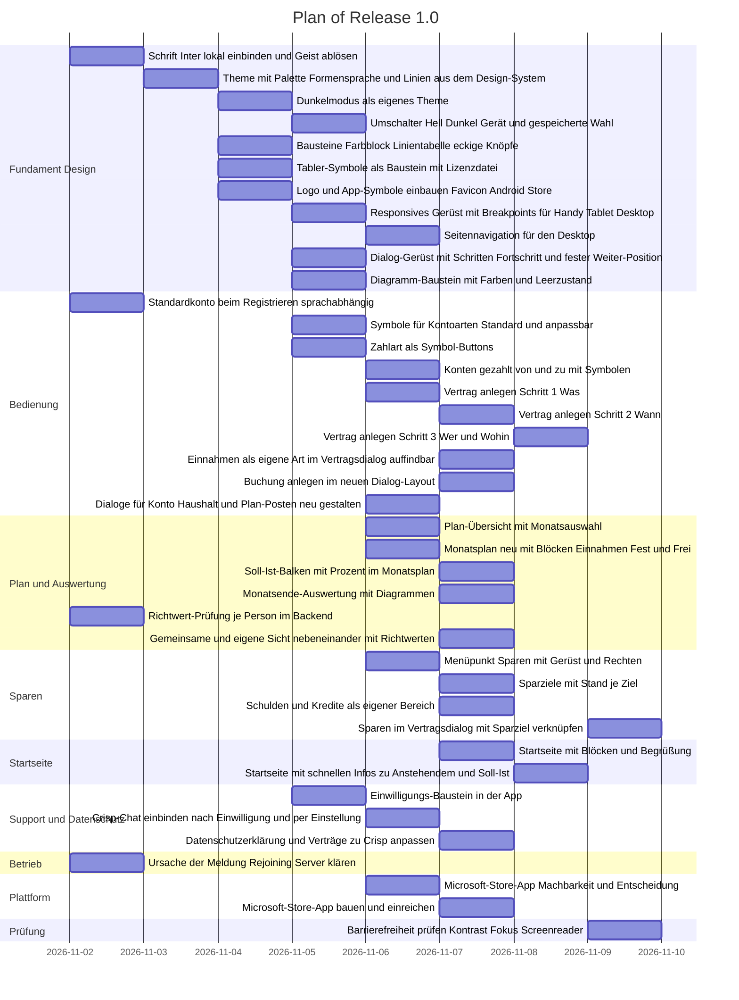

# Plan of Release 1.0

<!-- Quelle: Rundgang von Tom am 29.10.2026, Liste im Merkzettel project-release-1-0-scope-1029. Reihenfolge Design zuerst. -->

Ein Eintrag je Slice. Ziel sind Teile unter etwa 300 geänderten Zeilen. Wer die Aufgabe baut, ist ein Vorschlag und gehört dem Lead.

## Tasks

| id | what | depends on | who |
|---|---|---|---|
| F1 | Schrift Inter lokal einbinden und Geist ablösen | - | mia |
| F2 | Theme mit Palette Formensprache und Linien aus dem Design-System | F1 | kai |
| F3 | Dunkelmodus als eigenes Theme | F2 | kai |
| F4 | Umschalter Hell Dunkel Gerät und gespeicherte Wahl | F3 | mia |
| F5 | Bausteine Farbblock Linientabelle eckige Knöpfe | F2 | mia |
| F6 | Tabler-Symbole als Baustein mit Lizenzdatei | F2 | mia |
| F7 | Logo und App-Symbole einbauen Favicon Android Store | F2 | mia |
| F8 | Responsives Gerüst mit Breakpoints für Handy Tablet Desktop | F5 | kai |
| F9 | Seitennavigation für den Desktop | F8 | mia |
| F10 | Dialog-Gerüst mit Schritten Fortschritt und fester Weiter-Position | F5 | kai |
| F11 | Diagramm-Baustein mit Farben und Leerzustand | F5 | mia |
| B1 | Standardkonto beim Registrieren sprachabhängig | - | mia |
| B2 | Symbole für Kontoarten Standard und anpassbar | F6 | kai |
| B3 | Zahlart als Symbol-Buttons | F5, F6 | mia |
| B4 | Konten gezahlt von und zu mit Symbolen | B2 | mia |
| B5 | Vertrag anlegen Schritt 1 Was | F10 | kai |
| B6 | Vertrag anlegen Schritt 2 Wann | B5 | kai |
| B7 | Vertrag anlegen Schritt 3 Wer und Wohin | B6, B3, B4 | kai |
| B8 | Einnahmen als eigene Art im Vertragsdialog auffindbar | B5 | mia |
| B9 | Buchung anlegen im neuen Dialog-Layout | F10, B3, B4 | mia |
| B10 | Dialoge für Konto Haushalt und Plan-Posten neu gestalten | F10 | mia |
| P1 | Plan-Übersicht mit Monatsauswahl | F5, F8 | kai |
| P2 | Monatsplan neu mit Blöcken Einnahmen Fest und Frei | F5, F8 | kai |
| P3 | Soll-Ist-Balken mit Prozent im Monatsplan | P2 | mia |
| P4 | Monatsende-Auswertung mit Diagrammen | P2, F11 | mia |
| P5 | Richtwert-Prüfung je Person im Backend | - | kai |
| P6 | Gemeinsame und eigene Sicht nebeneinander mit Richtwerten | P2, P5 | kai |
| S1 | Menüpunkt Sparen mit Gerüst und Rechten | F8 | mia |
| S2 | Sparziele mit Stand je Ziel | S1 | kai |
| S3 | Schulden und Kredite als eigener Bereich | S1 | kai |
| S4 | Sparen im Vertragsdialog mit Sparziel verknüpfen | S2, B7 | mia |
| H1 | Startseite mit Blöcken und Begrüßung | P2 | mia |
| H2 | Startseite mit schnellen Infos zu Anstehendem und Soll-Ist | H1, P3 | mia |
| C1 | Einwilligungs-Baustein in der App | F5 | mia |
| C2 | Crisp-Chat einbinden nach Einwilligung und per Einstellung | C1, F7 | mia |
| C3 | Datenschutzerklärung und Verträge zu Crisp anpassen | C2 | kai |
| O1 | Ursache der Meldung Rejoining Server klären | - | kai |
| W1 | Microsoft-Store-App Machbarkeit und Entscheidung | F8 | kai |
| W2 | Microsoft-Store-App bauen und einreichen | W1, F7 | kai |
| A1 | Barrierefreiheit prüfen Kontrast Fokus Screenreader | P2, B7, H1 | rea |

## Chart

